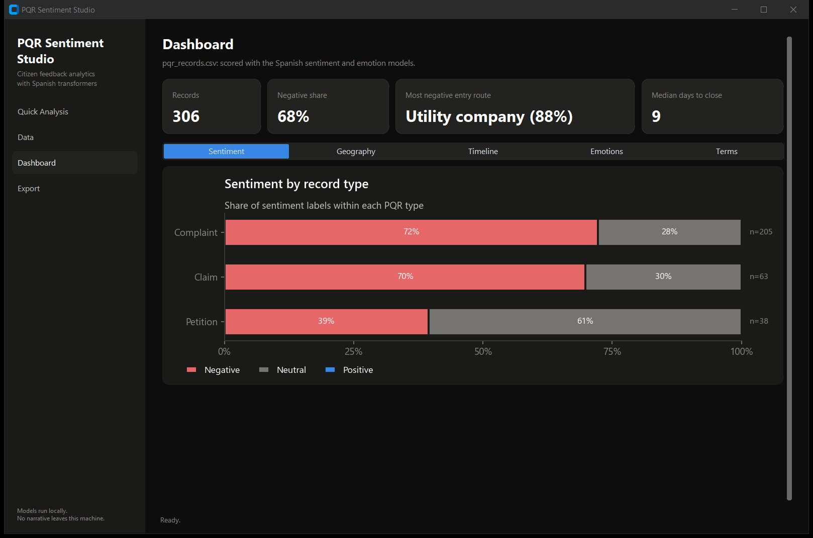
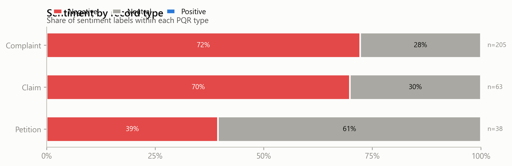
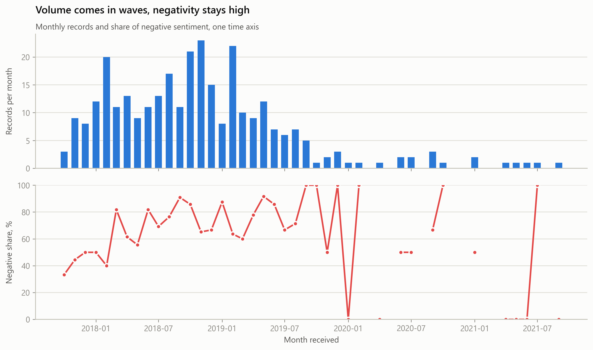
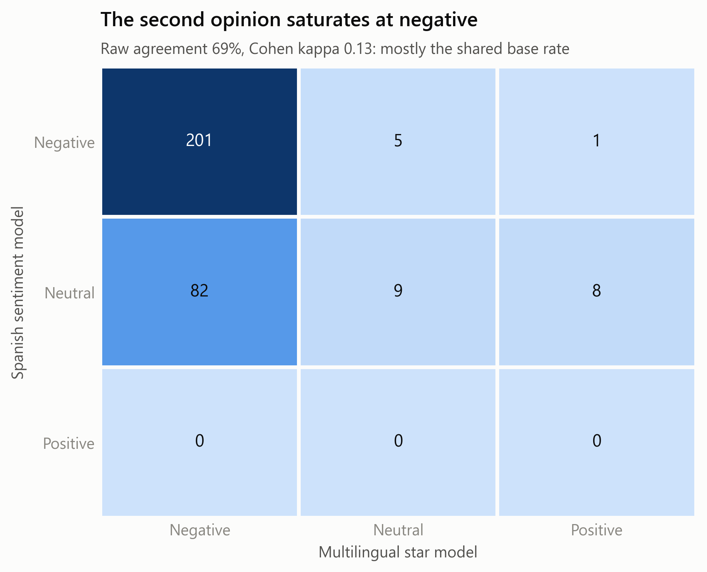
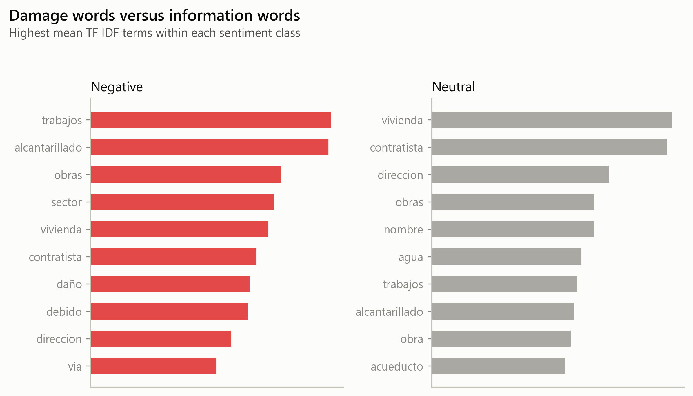
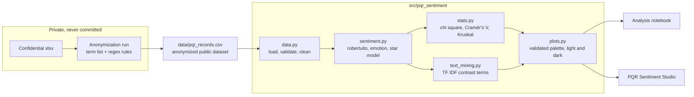
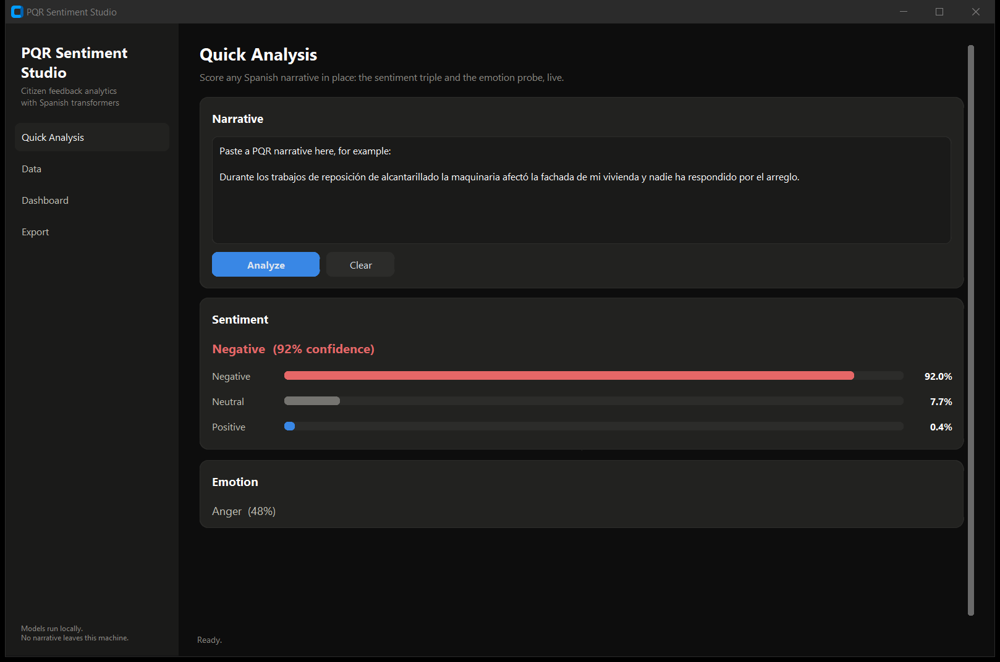
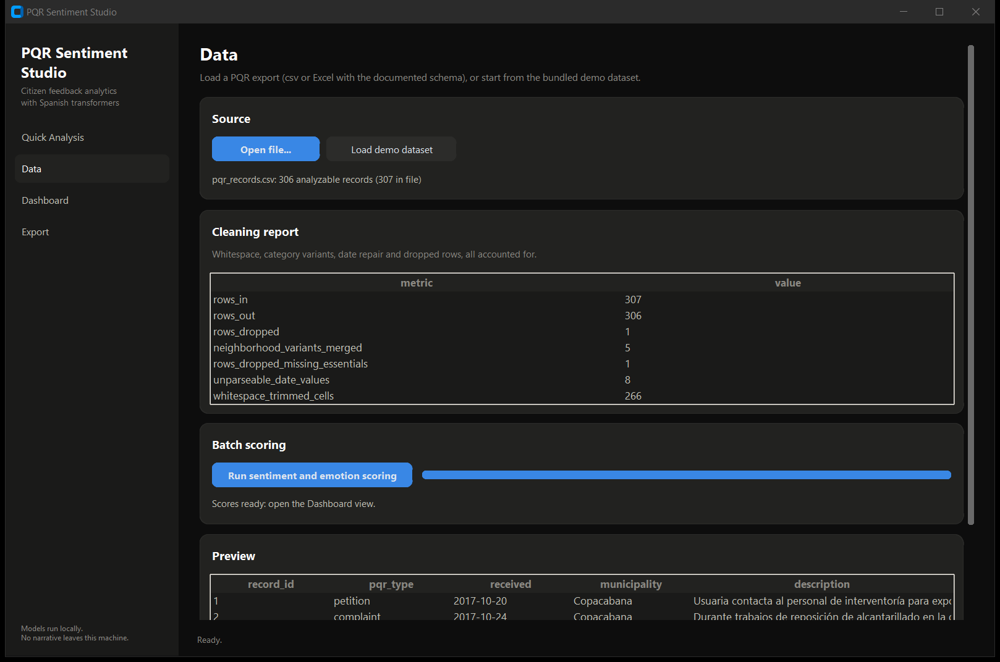

# PQR Sentiment Analysis

Transformer based sentiment and emotion intelligence on real citizen complaints from a public utility works program, delivered three ways: a reproducible analysis notebook, a tested Python package, and a standalone desktop application.


[](https://github.com/Alexey0424/pqr_sentiment_analysis/actions/workflows/tests.yml)



## The project in one minute

Colombian public service providers must operate a formal feedback channel called PQR: Peticiones, Quejas y Reclamos (petitions, complaints and claims). This repository analyzes 307 real PQR records filed between 2017 and 2021 during a sewer and aqueduct construction program in three municipalities of the Aburrá Valley, and turns the methodology into reusable software.

Three questions drive the analysis:

1. What do citizens feel when they write to the program, and how intense is it?
2. Where and when does negativity concentrate: type of request, entry route, geography, time?
3. Does feeling relate to operations: closure speed, regulatory deadlines, accepted responsibility?

## Key findings

: **68 percent of records are negative and not one is positive.** The channel is a pressure valve, so the useful signal is intensity and structure, not a positivity score.
: **Feeling follows the process, not the place.** Entry route (Cramér's V 0.25) and record type (V 0.21) carry the association: claims read 70 percent negative versus 39 percent for petitions, and the records that reach the utility company directly are 88 percent negative. Geography is flat: municipality V 0.04, nonsignificant.
: **The formal register hides emotion.** An emotion classifier trained on social media abstains on 92 percent of these bureaucratic narratives, an instructive domain shift result: polarity is the robust signal, not emotion.
: **A second model exposes why domain match matters.** An independent multilingual review model rubber stamps 93 percent of the corpus at 1 or 2 stars (Cohen kappa 0.13 against the Spanish model), while the Spanish native model is the one that separates calm petitions from angry claims.
: **Operations context:** median closure takes 9 days, only 38 percent of records close within the regulatory deadline, and negative records are not deprioritized (Kruskal Wallis p = 0.51).

## Analytics gallery

| | |
| :--: | :--: |
|  |  |
|  |  |

The full walkthrough, from raw data defects to statistical tests, lives in [`notebooks/pqr_sentiment_analysis.ipynb`](notebooks/pqr_sentiment_analysis.ipynb), executed end to end with every output embedded.

## Architecture

One tested package is the single source of truth; the notebook and the desktop studio are thin consumers of it.



The models: [`pysentimiento/robertuito-sentiment-analysis`](https://huggingface.co/pysentimiento/robertuito-sentiment-analysis) as primary scorer, [`pysentimiento/robertuito-emotion-analysis`](https://huggingface.co/pysentimiento/robertuito-emotion-analysis) for emotions, and [`nlptown/bert-base-multilingual-uncased-sentiment`](https://huggingface.co/nlptown/bert-base-multilingual-uncased-sentiment) as an independent second opinion.

## Quickstart

```powershell
git clone https://github.com/Alexey0424/pqr_sentiment_analysis.git
cd pqr_sentiment_analysis

# analysis stack only (tables and figures reproduce from the cached scores)
pip install -e ".[dev]"
pytest -q

# full transformer stack for live inference
pip install -e ".[ml]"
jupyter lab notebooks/pqr_sentiment_analysis.ipynb
```

The notebook runs live inference when the ML stack is present and falls back to `data/pqr_scored.csv` otherwise, so every table and figure reproduces on any machine in seconds.

## PQR Sentiment Studio

A standalone desktop application, the modern rework of the original ad hoc GUI: load any PQR export (csv or Excel), review an accountable cleaning report, run both transformers locally with live progress, read the dashboard, and export a chart pack. Everything runs on the local machine, no narrative leaves it.

```powershell
pip install -e ".[ml,app]"
pqr_studio
```

| Quick Analysis | Data intake |
| :--: | :--: |
|  |  |

A prebuilt Windows package is attached to the [latest release](https://github.com/Alexey0424/pqr_sentiment_analysis/releases); `scripts/build_exe.ps1` rebuilds it from source with PyInstaller.

## Data ethics and anonymization

The original records contain personal data and the identity of the companies involved, so the published dataset went through a rule based anonymization engine (`pqr_sentiment/anonymize.py`) before entering this repository:

: dropped outright: names, national identity numbers, addresses, phone numbers and two unanalyzed free text columns,
: masked inside the narratives with typed placeholders: person names to `[NOMBRE]`, phones to `[TELEFONO]`, street addresses to `[DIRECCION]`, identity documents to `[DOCUMENTO]`, vehicle plates to `[PLACA]`, serials to `[SERIE]`, and every corporate identity to `[EMPRESA]`, `[CONTRATISTA]` or `[ORGANIZACION]`,
: verified by an automated audit: structural PII patterns, every raw name, phone and document value, and the full forbidden term list return zero hits on the published file.

The real term list stays outside version control; `data/sensitive_terms.example.json` documents its format. Municipality, watershed and neighborhood names are public geography and remain, since the spatial analysis depends on them. The provider behind the program is intentionally not disclosed anywhere in this repository.

## Dataset

`data/pqr_records.csv`, 307 rows, one per PQR record, Spanish narratives with English snake_case headers:

| Column | Meaning |
| :-- | :-- |
| `record_id` | Consecutive identifier from the source system |
| `pqr_type` | Petición, Queja or Reclamo, normalized to petition, complaint, claim |
| `received_date`, `due_date`, `attended_date`, `closed_date` | Lifecycle dates, kept exactly as exported, defects included |
| `entry_route` | Contractor, supervision firm or utility company |
| `watershed`, `municipality`, `neighborhood` | Where the triggering works happen |
| `description` | The citizen narrative, anonymized, original Spanish |
| `attributable` | Whether the operator accepted responsibility |
| `status` | Open or closed |

The raw values ship uncleaned on purpose: trailing whitespace categories, six case variants of the responsibility flag, duplicate neighborhood spellings, Excel serial dates next to day first strings, and impossible dates like `31/02/2019`. The cleaning pipeline in `data.py` repairs what can be repaired and accounts for every decision in a report, which the notebook walks through defect by defect.

## Project structure

```
pqr_sentiment_analysis/
    src/pqr_sentiment/        the package: config, data, anonymize, sentiment,
                              text_mining, stats, plots, app/
    notebooks/                executed analysis notebook
    data/                     anonymized dataset, cached model scores
    reports/figures/          publication ready charts (written by the notebook)
    reports/screenshots/      desktop studio captures
    tests/                    72 unit tests, no network, no model downloads
    packaging/, scripts/      PyInstaller spec and build script
```

## Built with

Python 3.10+, pandas, matplotlib, scipy, `scikit-learn`, PyTorch, Hugging Face transformers, pysentimiento, CustomTkinter, pytest, GitHub Actions.

## License

MIT, see [LICENSE](LICENSE).
